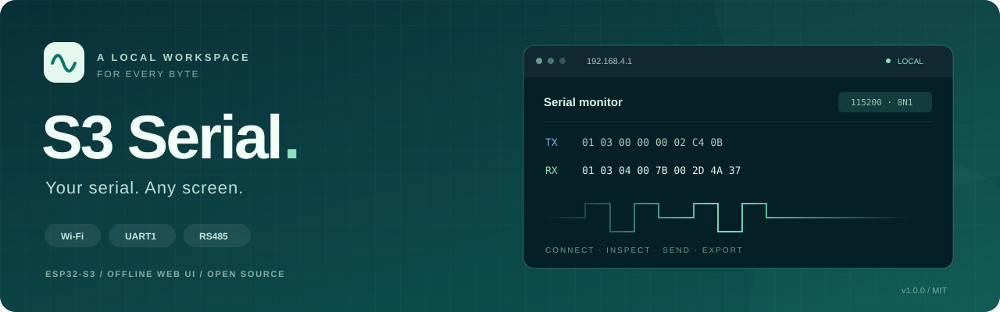
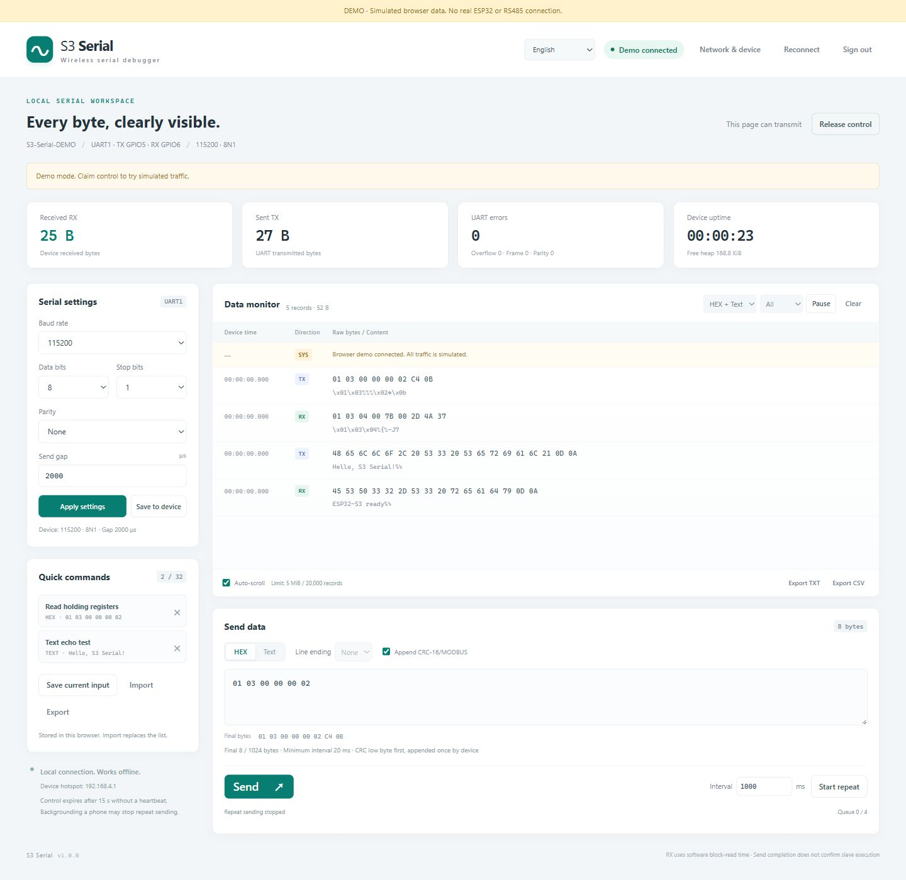
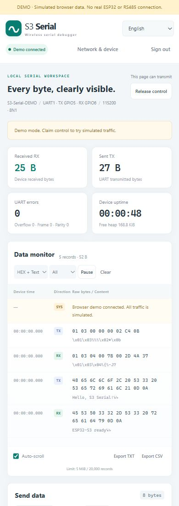
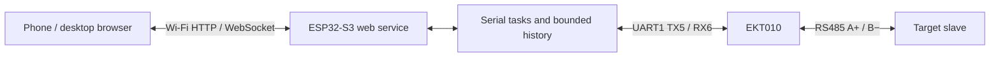

<div align="center">



[English](README.md) · [简体中文](docs/readme/README.zh-CN.md) · [繁體中文](docs/readme/README.zh-TW.md) · [日本語](docs/readme/README.ja.md) · [한국어](docs/readme/README.ko.md)

# S3 Serial

### Turn an ESP32-S3 into a pocket Wi-Fi serial and RS485 debugger.

**Your serial. Any screen. Every byte, clearly visible.**

[](CHANGELOG.md)
[](docs/HARDWARE.md)
[](docs/BUILD.md)
[](LICENSE)

[Quick start](#quick-start) · [Screenshots](#screenshots) · [Languages](#languages) · [Hardware](docs/HARDWARE.md) · [Build & flash](docs/BUILD.md) · [Documentation](#documentation)

</div>

---

S3 Serial connects an ESP32-S3 UART to an EKT010 TTL-to-RS485 module and exposes a local browser workspace for serial configuration, HEX/text traffic, timed sending and log export. All application assets and translations are embedded in firmware. No cloud, npm build or internet connection is required to use the device.

> [!NOTE]
> v1.0.0 is the first public release. Firmware builds and automated tests pass; earlier development firmware has booted on hardware. This exact public build has not yet been flashed. Real RS485 round trips, turnaround timing and endurance tests remain pending. This is a raw serial debugger with Modbus CRC assistance, without a complete Modbus master transaction engine.

## Screenshots



<div align="center">

</div>

These are real browser captures of the explicit demo. The mobile image uses a simulated phone viewport, not a physical phone. Sample traffic is generated in the browser and is not evidence of a successful RS485 transaction. [More screenshots](docs/SCREENSHOTS.md).

## Languages

**English is the default**, regardless of browser language. Use the language selector to choose English, 简体中文, 繁體中文, 日本語 or 한국어. The browser remembers your choice. If storage is unavailable, switching still works for the current page.

Menus, dialogs, validation, connection status and send feedback are translated. Switching does not reconnect, apply UART settings, transmit data or replace your draft. Historical logs, user-entered command names, raw traffic and device diagnostic strings retain their original content. Detailed engineering guides are currently in Simplified Chinese; the five README editions summarize setup, operation and limits in each language.

## Features

| Area | Included in v1.0.0 |
|---|---|
| Local access | Password-protected Wi-Fi AP, `http://192.168.4.1`, optional AP+STA |
| UART | 1200–115200 baud, 5–8 data bits, N/E/O parity, 1/2 stop bits; preset and custom baud rates |
| Traffic | HEX, UTF-8 or both; TX/RX filters, software timestamps and UART error counters |
| Modbus assistance | CRC-16/MODBUS preview and optional append, low byte first |
| Repeated work | Device-side timed sending, busy-interval skipping, 32 quick commands with JSON import/export |
| Logs | TXT/CSV export, bounded history recovery, gap and eviction notices |
| Multiple pages | Up to 3 debugger pages: 1 controller and 2 observers |
| Interface | Responsive desktop/mobile layout; five offline languages |

## Quick start

### 1. Wire the hardware

Use an ESP32-S3-WROOM-1 development board, EE Maker EKT010, a USB data cable and jumper wires. Real communication also requires a separately powered RS485 slave and its manual.

| ESP32-S3 | Direction | EKT010 | This cable harness |
|---|:---:|---|---|
| 3V3 | → | VCC | Red |
| GND | — | GND | **Blue** |
| GPIO5 / UART1 TX | → | RXD, module input | **Black** |
| GPIO6 / UART1 RX | ← | TXD, module output | Yellow |

**Blue is ground; black is RXD for this harness.** Follow labels and continuity checks for other cables. Connect A+ and B− to the corresponding slave signals; reference ground and slave power must follow its manual. B− is a communication signal, not a power-negative terminal. There is no external DE/RE pin or direction-control GPIO in this setup. [Wiring diagram and board notes](docs/HARDWARE.md).

### 2. Build and flash

Install and activate **ESP-IDF v5.5.1**, then run from the project root:

```sh
idf.py set-target esp32s3
idf.py build
idf.py -p YOUR_PORT flash monitor
```

Replace `YOUR_PORT`, for example `COM14` on Windows or `/dev/ttyACM0` on Linux. The firmware uses a 4 MB Flash address space and does not require PSRAM. [Build instructions and prebuilt images](docs/BUILD.md).

### 3. Connect the browser

Read `Hotspot` and `Device / Wi-Fi password` in the USB boot log. Join `S3-Serial-xxxx` and open **http://192.168.4.1**. A random password is generated and saved on first boot; Wi-Fi and web sign-in use the same device password. There is no universal password in this repository.

Claim control, match the slave's baud rate and parity, and select **Apply settings**. Select **Save to device** after confirmation to persist settings across restarts. The UART fallback is 115200/8N1 when no settings are saved; this does not establish the slave's configuration.

### 4. Send a known request

Use this example only when slave address 1 supports reading two holding registers from protocol address `0x0000`:

```text
HEX input:       01 03 00 00 00 02
Enable:          Append CRC-16/MODBUS
Final bytes:     01 03 00 00 00 02 C4 0B
Example reply:   01 03 04 00 7B 00 2D 4A 37
```

If you enter the full eight-byte request, disable CRC append. Serial parity and message CRC are separate checks. A completed UART send does not prove slave reception or execution. [Modbus examples and troubleshooting](docs/MODBUS.md).

## Try it without hardware

```sh
python tools/preview.py
```

Open `http://127.0.0.1:8765/?demo=1`. The explicit demo banner stays visible; all traffic is simulated and no device port is opened. Normal device operation uses `/` without `demo=1`.

## How it works



Serial receive, serial write, networking and control-lease checks use separate tasks. Lost control cancels work that has not started; a frame already transmitting may finish. Reconnection never automatically replays a command or resumes a repeat job. [Architecture](docs/ARCHITECTURE.md).

## Tests and limits

- **17 frontend tests pass**, covering CRC, demo history, five-language coverage, placeholders, preference storage, validation and unchanged payload bytes.
- The strict C11 serial-core suite passes. ESP-IDF compilation, linking, partition checks and firmware checksum verification pass.
- Desktop and mobile viewports have been checked. GitHub CI is provided but has not yet run in a target repository. [Verification scope](docs/VERIFICATION.md).
- RX records are UART read blocks, not guaranteed Modbus frames. There is no automatic RX CRC validation, request/reply pairing, exception decoding or reply timeout.
- Timed sending does not wait for slave replies. Include the slave's processing and response time when choosing a period.
- Control expires after 15 seconds without a heartbeat. Phone backgrounding can stop repeat jobs.
- Browser history is bounded to 5 MiB raw bytes / 20,000 records; device history to 32 KiB / 512 records. Evicted records cannot be exported and device RAM history does not survive power loss.
- BLE, OTA and persistent offline capture are not implemented. Use the service on a local AP or trusted LAN.

## Documentation

The engineering guides below are in Simplified Chinese; the [localization guide](docs/LANGUAGES.md) is in English. Protocol field names and command examples remain language-independent.

| Topic | Guide |
|---|---|
| Pins, wire colors, power and RS485 terminals | [Hardware](docs/HARDWARE.md) |
| Controls, settings, repeat jobs and export | [Usage](docs/USAGE.md) |
| SDK, building, flashing and recovery | [Build](docs/BUILD.md) |
| Frames, CRC and transaction limits | [Modbus](docs/MODBUS.md) |
| Tasks, budgets and wire protocol | [Architecture](docs/ARCHITECTURE.md) · [Protocol](PROTOCOL.md) |
| Common problems | [FAQ](docs/FAQ.md) |
| Results and screenshots | [Verification](docs/VERIFICATION.md) · [Screenshots](docs/SCREENSHOTS.md) |
| GitHub upload and release attachments | [Publishing](docs/PUBLISHING.md) · [Release notes](docs/RELEASE_v1.0.0.md) |
| Tests, contributions and changes | [Testing](TESTING.md) · [Contributing](CONTRIBUTING.md) · [Changelog](CHANGELOG.md) |

## License and credits

Original code, documentation and project artwork use the [MIT license](LICENSE). Use, modify, distribute and commercialize while preserving the copyright and license notice. ESP-IDF and other dependencies retain their own licenses; see [third-party notices](THIRD_PARTY_NOTICES.md).

Thanks to Espressif for ESP-IDF. The repository presentation takes inspiration from [morluto/rea](https://github.com/morluto/rea); its brand artwork and implementation code are not used.
