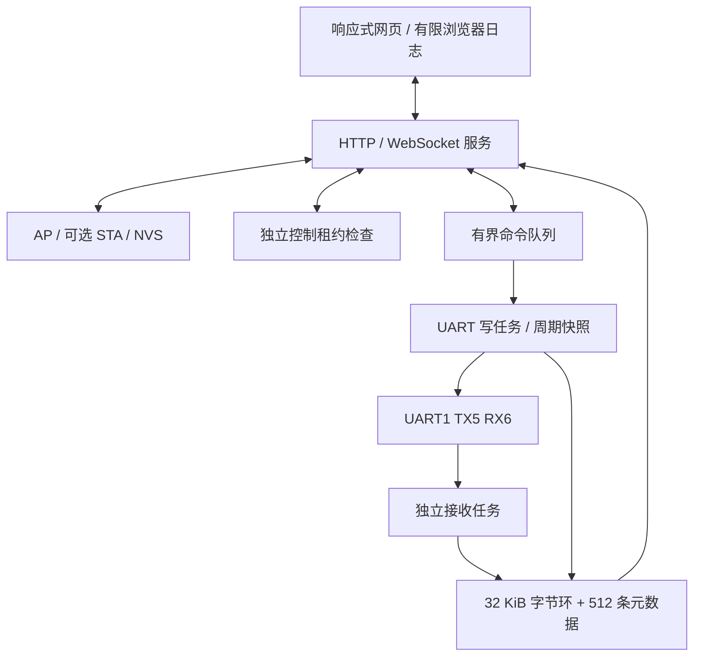

# 架构与资源边界

串口服务负责唯一写任务、参数切换、CRC、周期调度与历史。网络服务负责热点、路由器配置、密码与网段重叠处理。Web 服务负责登录、会话、控制权、消息边界与每客户端历史游标。

| 资源 | 限制 |
|---|---|
| UART RX / TX 驱动缓冲 | 16 KiB / 2 KiB |
| 命令队列 | 4 项 |
| 最终单次 TX | 1024 字节，含 CRC |
| 设备历史 | 32 KiB 原始字节 + 512 条元数据 |
| 调试页面 / 控制者 | 3 / 1 |
| 会话 | 8 |
| WebSocket 输入 / 输出 | 4096 / 8192 字节 |
| 浏览器保留 | 5 MiB 原始字节或 20000 条，先到者限制 |
| 浏览器渲染 | 最近 1000 行 |
| 心跳 / 失联租约 | 5 s / 15 s |
| 定时周期 | 20 ms～1 h，且满足线时间及发送间隔 |

撤销控制权、退出或失联会取消未开始工作，已开始报文允许完成。不对结果未知的发送自动重放。周期任务保存启动时字节快照，忙时跳过，不积压补发。

参数更新有配置版本与控制权代次检查，暂停 RX 后切换；必要的丢弃或缺口单独报告。硬件溢出不能精确得知丢字节数时不伪造精确数字。

时间戳来自 ESP 单调时钟，RX 为软件读块时间，TX 为 UART 完成时间，不能据此测量精确总线逐字节时序。主机测试、浏览器演示、实板启动和真实协议通信为不同验证层次，详见 VERIFICATION.md。
