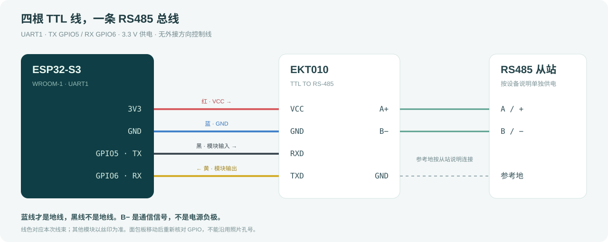

# 硬件与接线

## 当前硬件

ESP32-S3-WROOM-1 开发板与 EE Maker EKT010 TTL TO RS-485。当前实板读取到 Flash 16 MB、Embedded PSRAM 8 MB；公开固件只使用 4 MB 地址空间，不依赖 PSRAM。其他开发板仍需自行确认 GPIO、Flash 和 USB 电路。

| ESP32 | 模块接口 | 方向 | 本次线色 |
|---|---|---|---|
| 3V3 | VCC | → 模块 | 红色 |
| GND | GND | 共地 | 蓝色 |
| GPIO5 / UART1 TX | RXD，模块输入 | → 模块 | 黑色 |
| GPIO6 / UART1 RX | TXD，模块输出 | ← 模块 | 黄色 |

**黑线不是地线，蓝线才是地线。** 线色只代表本次线束；其他厂商或线束以模块丝印和实际导通关系为准。板上单独标注的 TX/RX 不是本工程 GPIO5/6。

模块 TTL 端只有四线，没有外接 DE/RE，不增加方向控制 GPIO。软件使用 UART_MODE_UART，关闭 RTS/CTS 流控，由模块处理方向；实际换向性能仍需测试。模块丝印供电 3.3～5 V，当前使用 3.3 V；不能仅凭供电范围推定所有条件下的 TTL 输出电平。

## RS485 侧

- 绿色端子 A+ → 从站对应 A/+。
- 绿色端子 B− → 从站对应 B/−；B− 是通信信号，不是电源负极。
- 参考 GND 按从站说明连接，从站按说明书单独供电。
- 终端与偏置电阻按实际模块资料和总线拓扑确认，不从外观假定已内置。首次测试可用短线与一个从站。

## 本次照片对应的面包板孔位

这只是此前照片特定摆放的定位记录，不是通用引脚图：编号从左到右 1～30，ESP 元件面朝上、两个 USB 朝左、天线朝右，使用上方最外侧紧挨编号下方的 j 排。

| 孔位 | 连接 |
|---|---|
| j30 | 红线 VCC → 3V3 |
| j9 | 蓝线 GND → GND |
| j25 | 黄线 TXD → GPIO6 |
| j26 | 黑线 RXD → GPIO5 |

开发板移动或旋转后重新核对，以丝印为准；不要混用此前 b1～b22 / j1～j22 的另一套摆放。公开文档以 GPIO 接线表为主，未附私人原始照片。

## 串口与旧项目边界

本次 Modbus 使用 UART1、TX5、RX6、8 数据位、1 停止位。波特率和校验位待与从站核对，不能擅自认定为 9600 或无校验。软件无已保存配置时初始为 115200/8N1，NVS 保存值会覆盖它。

旧项目 UART2 4G DTU 的 GPIO12/13 与本次测试分开。旧固件轮询地址 1、27、29，`err=-11` 与 `last_err=-1` 不属于当前工程的错误码，须查旧源码解释。此前 A/B 未接从站时的失败日志不能证明转换模块损坏或通信成功。
