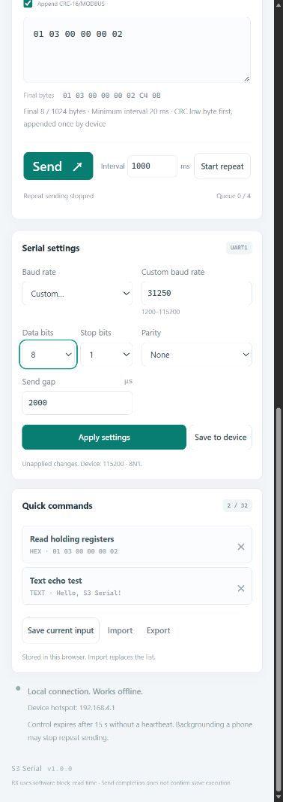

# 页面截图

截图来自公开版同一套真实网页，默认英语，右上角可选择五种语言；使用显式 ?demo=1 模式。桌面 1440 CSS 像素宽；手机 390 CSS 像素宽。手机截图为浏览器视口模拟，不是实体手机采集。截图中 RX/TX 为演示数据，不能作为 RS485 已成功的证据。

## 电脑端

## 手机端

## 手机端串口参数

截图不包含真实设备密码、Cookie、私人网络配置或设备唯一标识。重新截图时请保留演示模式说明。
